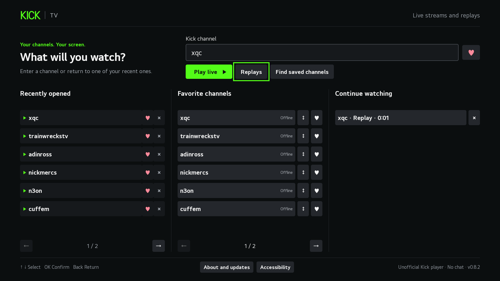
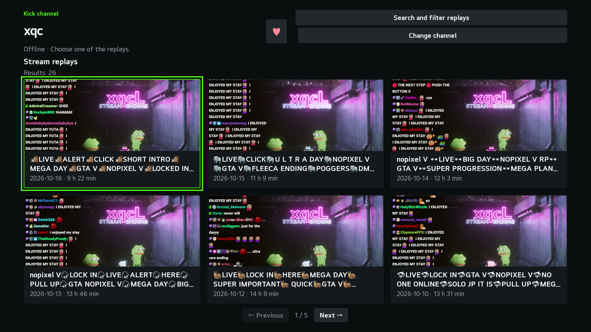
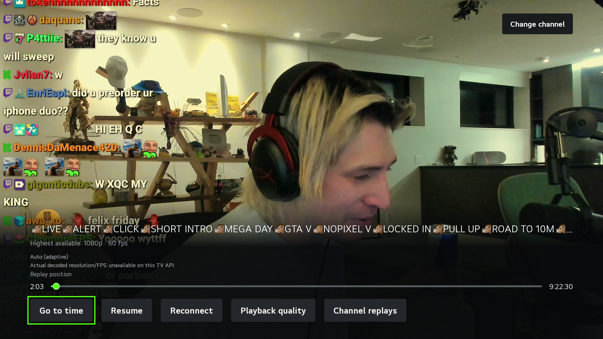

# Kick for LG webOS

[](https://github.com/JirakJ/kick-web-os-app/actions/workflows/ci.yml)

An unofficial, chat-free Kick player for LG webOS TVs. Choose a channel and watch live streams or public replays through the TV's native video player. The app and its small JavaScript service run on the TV; no computer or external proxy needs to stay on.

The interface follows the TV's system language (Czech, Slovak, English, German, Polish, Spanish, Portuguese, French, Italian, Hungarian, Ukrainian, Russian and Turkish; other languages fall back to English) and uses Kick-inspired black and green styling.

[Download the latest installable IPK](https://github.com/JirakJ/kick-web-os-app/releases/latest).

**Development candidate: 0.8.0.** The latest published stable release is 0.7.5. New features are being delivered sequentially with GHA checks; real-TV acceptance is planned for the owner's afternoon session. No 0.8.0 release is published before that acceptance.

## Features

- Live streams and public replays, including a replay picker when a channel is offline.
- Up to 50 independently ordered favorite channels, six per page, with remote-only move/save/cancel controls and visible LIVE/offline/unknown status.
- Up to 50 recent channels stored locally, six per page, with a **LIVE** badge for live channels and an individual remove button.
- Interface language taken from the TV's locale, including the launcher title, with English as the fallback.
- Replay thumbnails, titles, dates and durations, with six recordings per page.
- Last-watched and previously watched replay badges, with the last played position stored locally.
- A seek bar without a focus rectangle, pause/resume and remote controls; playback controls hide after six seconds of inactivity.
- About and updates shows installed/latest stable versions and short plain-text release notes. Checks are viewer initiated against the fixed official GitHub repository, cached for six hours with failure/rate-limit backoff. It provides Dev Manager/existing Homebrew installation and rollback guidance; no in-app installer. Offline saved results are labelled as potentially outdated.
- Go to time accepts hours/minutes/seconds, previews a duration-clamped target and offers Confirm/Cancel. Fast-forward/rewind opens a ±10-minute preview; short timeline arrows remain ±10 seconds.
- Find saved channels locally; search replay titles, filter by viewing history and sort newest/oldest within the loaded catalog of up to 30 public replays. Six visible results per page; Back cancels changes and restores focus.
- Network reconnect refreshes validated live/replay sources with two bounded attempts; offline flapping retains the budget. Pause, hide and Back cancel pending recovery. Manual Reconnect preserves pause intent. Real outage acceptance remains pending.
- Auto quality up to 4K: 2160p → 1440p → 1080p → lower resolutions. Native adaptation remains enabled for slower connections. The quality menu also offers validated self-contained HLS renditions; fixed quality preserves position/pause, while playlists with separate audio require Auto. Preferences are local; missing renditions fall back explicitly to Auto. Actual decoder resolution/FPS is unavailable through the supported app API.
- Serialized seeking, bounded recovery after media errors, request timeouts and cleanup when leaving the player.

No chat, account login, private videos or analytics.

## Screenshots

Captured from version **0.6.0** (Czech interface) running on an LG 55NANO863NA at 1920 × 1080 on 12 September 2026.







## Build

Use a supported Node.js version (`^22.22.2`, `^24.15.0` or `>=26`) and npm 12. The `.nvmrc` selects Node.js 22.

```sh
nvm install
nvm use
npm install --global npm@12.0.2
npm ci
npm test
npm run package
```

The output is `dist/com.jakubjirak_0.8.0_all.ipk`. It contains both the app (`com.jakubjirak`) and its service (`com.jakubjirak.service`), which must be installed together. CI runs the tests and uploads the built IPK as a workflow artifact.

Build dependencies pin security updates and two documented [local backports](vendor/security/README.md) for fixes that have no official release yet. `npm test` also checks the installed CLI dependencies against hostile brace patterns, proxy trust inputs and numeric precision values. These development dependencies are not shipped to the TV.

The webOS CLI is a development dependency. The service uses the TV's built-in `webos-service` module and Node.js standard libraries; it does not ship npm dependencies. The service runtime target is Node.js **0.12.2 or newer**, including the runtime reported on LG UJ6307 (2017) / webOS 3.5. The build-tool Node/npm requirements above apply to the development computer, not the TV. The existing webOS 5 device uses Node.js 8.12.0.

Version 0.7.1 fixes Claire's [legacy-TV report (#2)](https://github.com/JirakJ/kick-web-os-app/issues/2): it removes `Array.from` from the service and UI, avoids the unavailable WHATWG `url.URL`, preserves complete emoji when truncating titles, and tolerates TV builds without Unicode normalization. A flexbox replay layout preserves the 3/2/1-column remote navigation on engines without CSS Grid. Signed playlist query strings keep their existing percent escapes. TLS verification and exact media-host allowlists remain enabled; redirects remain disabled. Connection-reset retries use a fresh connection instead of another socket from the stale keep-alive pool.

`npm test` includes `test-service-legacy.js`, an ES5-only service integration test with real local HTTP streams and gzip. CI also runs that script directly on Node.js 0.12.2 and 8.12.0 without installing modern build dependencies. To repeat the legacy check locally:

```sh
/path/to/node-v0.12.2/bin/node test-service-legacy.js
```

The local test replaces only the HTTPS transport and Luna service registration; it does not verify Kick's live TLS endpoint, native video decoding or Developer Mode installation. Installation, live playback and replays on LG UJ6307 / webOS 3.5 still need an on-device check.

## Install on a TV

Install the IPK with [webOS Dev Manager](https://github.com/webosbrew/dev-manager-desktop):

- On an already rooted webOSbrew TV, use its SSH/Homebrew connection. The tested installation runs without the timed LG Developer Mode application.
- On a TV using LG Developer Mode, the normal session and installation expiry rules apply.

Version 0.7.2 uses application ID `com.jakubjirak` and service ID `com.jakubjirak.service`. This is a new application identity compared with 0.7.1 and earlier (`cz.jirak.kicktv`): it installs alongside the old application and starts with its own recent channels and replay history. Existing data remains with the old application; there is no automatic migration. Subsequent updates using the new ID preserve the new application's data. This IPK is an application package, not an LG firmware update, and does not root or modify TV firmware. The app has not been published in the LG Content Store; store distribution requires LG approval.

## Controls

Button labels below are the English strings; the app shows them in the TV's language (for example **Přehrát živě** on a Czech TV).

| Action | Control |
| --- | --- |
| Select a channel | Enter its name or `https://kick.com/channel` |
| Start live playback | **Play live**, or select a recent channel |
| Browse replays | **Replays**; arrows move through cards and page buttons |
| Favorite/unfavorite a channel | **Add favorite / Remove favorite** on home or in its catalog |
| Reorder favorites | **Move**, then **Move up / Move down**, **Save**; **Back** cancels the preview |
| Remove a saved channel | Select **×** beside its name; **← / →** moves between the channel and remove button |
| More recent channels | Use the arrow buttons below the list |
| Confirm | **OK** |
| Pause/resume | **OK** on the video or seek bar; dedicated Play/Pause buttons also work |
| Seek in a replay | **← / →** on the video or seek bar, in 10-second steps |
| Jump to a position | Select a point on the seek bar with Magic Remote |
| Return to the channel's recordings | **Back** from playback or **Channel replays** |
| Choose another channel | **Change channel** |

Controls remain visible while paused or when an error needs attention. Leaving the app releases the decoder. On return, choose **Resume** to resume from the previous replay position within the same app session.

Replay cards show **Last watched** on the most recently played recording, **Watched · time** for previous playback, and **Watched** (completed) when playback reached the end, including after seeking. The thumbnail bar shows the last played position, not watched-segment coverage. Selecting an unfinished replay offers **Continue from time** or **Start over**. Completed and near-end recordings start from the beginning. **Continue watching** on home shows six entries per page, resolves public metadata with two cancellable workers, and allows removing unavailable entries. Media addresses are refreshed when opening an item.

History starts with version 0.5.0 and keeps the 200 most recently played replays on this TV. Opening a video or seeking while paused does not mark it as watched. Progress is saved every ten seconds and when pausing or leaving; an abrupt power loss can lose the latest few seconds. Only channel/video IDs, position, duration and completion state are stored, without titles or signed media URLs. Clearing app data removes this history.

## Local development and validation

```sh
npm test
npm start
```

The preview is served at `http://127.0.0.1:8080`. Luna services and native media behavior require a webOS TV; the browser preview alone cannot verify playback.

Tests use DOM and media substitutes to check validation, history, navigation, pagination, seeking, stale events, recovery limits, lifecycle changes and service failures. They also exercise request coalescing, concurrency limits, oversized responses and disconnected clients. They do not decode real media.

Version 0.4.1 was checked on an LG 55NANO863NA running firmware 04.64.00 and webOS 5.6.2 on 12 September 2026. Device checks covered live and replay video at 1080p/60, paused seeking, rapid seek and pause/play input, channel switching, pagination, hidden controls and background/resume behavior. A four-minute playback run after the input stress test kept one decoder active without an observed error.

Version 0.5.0 was checked on the same TV for repeated emoji in Astatoro's replay titles, normal text spacing, replay badges and saved positions after restarting the app. Completion was checked by seeking the native player near the end and letting playback finish. Supplementary symbols render separately to avoid the older webOS renderer corrupting repeated emoji.

Version 0.5.1 adds a bundled emoji fallback for missing glyphs such as Czechfather's 🪖 and 🫡. Native color emoji take precedence; missing glyphs use monochrome Noto Emoji. The fallback applies only to symbol spans and excludes letters, digits and spaces, preserving normal text spacing. Font coverage and the actual fallback glyphs were checked locally, alongside regression tests. This version has not yet been checked on the TV, which was powered off during the fix.

Version 0.5.2 extends fallback routing to BMP emoji such as ⚔️, ⚠️, ⛽, ✍️, ❌ and ❣️, and keeps compound emoji intact. The [channel symbol audit](docs/symbol-audit.md) covers 681 titles from 35 channels, including 19 channels outside the initial sample. All 68 sampled emoji sequences were checked against the bundled font, rendered locally and added to catalog/player regressions. These local checks do not verify the TV renderer; the TV remained powered off.

Version 0.6.0 was checked on the same TV for real live/replay playback, native seeking, the borderless seek bar, channel removal and LIVE badges. The screenshots above show this version. The [production audit](docs/production-audit.md) records security scan scope, rendering operation counts and layout checks executed in the TV's own browser. `test-layout.cjs` supplies the geometry checker for the installed app's Web Inspector; it does not open a local browser.

Version 0.7.0 selects the interface language from `webOSSystem.locale` (falling back to `PalmSystem.locale` and the browser language) and ships localized launcher titles in `app/resources/<language>/appinfo.json`. The service now negotiates gzip for Kick responses and reuses TLS connections; measured against Kick on 12 September 2026, the channel document shrank from 8.8 KB to 2.4 KB and a 30-replay list from 64 KB to 7.5 KB on the wire. Service errors carry stable codes that the app translates. The gzip and connection-reuse paths were also exercised on a real Node 8.12.0 binary, matching the TV's service runtime. Regression tests cover all 13 languages (key coverage, placeholder parity, locale detection, launcher resources, translated service errors, compressed and malformed transfers). The TV was unreachable during this release, so the language switch, launcher title resources and gzip path were verified locally and in the packaged IPK only, not on the device.

Version 0.7.4 was checked on the LG 55NANO863NA / webOS 5.6.2 for Czech localization, real live and replay playback at native 1080p/60, pause, paused and rapid seeking, remote navigation, pagination, hidden controls and decoder cleanup. Its installed app/service payload matched the IPK, and the service integration suite also passed on the TV's Node.js 8.12.0. See the [current audit](docs/production-audit.md) for scope and limits.

Version 0.7.5 fixes seek targets lost during decoder recovery, orphan seek timers and retained video resources. On the same TV, 16 replay start/return cycles and 50 pagination cycles kept settled catalog counts at 334 DOM nodes and 43 listeners. Returning home released replay thumbnails and the decoder. Controlled tests reduced watchdog allocations from 240 to 3 per simulated minute and bounded idle HTTPS sockets to two across 25 origins. The [current audit](docs/production-audit.md) records the measurements and remaining device coverage limits.

Recent-channel status is refreshed while the home screen is visible, using channel metadata only. A failed lookup shows no LIVE badge. Checks use two workers per batch, leave request capacity for playback and stop polling when the app leaves the home screen. Removing a channel preserves its replay viewing history; opening that channel again adds it back to the recent list.

This is not a guarantee of crash-free operation. Several-hour playback, router outages, screensaver behavior and actual 4K/1440p playback have not been verified. The TV reported an active, unmuted audio track; audible output was not independently checked. The quality label reports the source's highest available resolution, not a measurement of the current adaptive level.

## Architecture and limits

- `app/`: HTML/CSS, remote navigation, the native media controller and `i18n.js` with the interface strings for every supported language.
- `service/`: validated HTTPS requests for channel information, public replays and HLS quality metadata.
- `test.cjs`: local regression and failure-path checks.
- `test-player-resources.cjs`: retired-video collection with an unresolved play promise.
- `test-service-resources.js`: real-socket origin and keep-alive resource limits.

The service uses Kick's web endpoints (`/api/v2/channels/{channel}` and `/videos`), which are not a stable documented public API. Kick may change or restrict them. HTTP errors are shown in the app. Only allowlisted Kick media and thumbnail hosts are accepted, TLS validation remains enabled, and remote titles render as text.

Requests are limited to 1 MiB of decoded text, 12 seconds and six concurrent connections; gzip responses are inflated incrementally and stopped at the same limit. Playback recovery makes at most two attempts before asking the viewer to retry. These controls bound resource use and recovery; they cannot fix a platform outage or an unsupported TV decoder.

The green launcher icon is documented in [icon-source.md](docs/icon-source.md).

This project is not affiliated with or endorsed by Kick or LG.

The bundled [Noto Emoji font](app/fonts/README.md) is Copyright 2013 Google LLC and licensed under [SIL OFL 1.1](app/fonts/OFL.txt). It is included in the IPK and does not require a network download.

References: [LG JavaScript services](https://webostv.developer.lge.com/develop/guides/js-service-usage), [HLS support](https://webostv.developer.lge.com/faq/streaming-http-live-streaming-hls-troubleshooting), [media options](https://webostv.developer.lge.com/develop/guides/mediaoption-parameter), [resuming media](https://webostv.developer.lge.com/develop/guides/resuming-media-with-mediaoption).

Update metadata uses the [GitHub Releases API](https://docs.github.com/en/rest/releases/releases#list-releases). SHA256SUMS checks integrity, not publisher signatures. Same-ID installation preserves app storage; actual upgrade/rollback acceptance remains a TV check.
